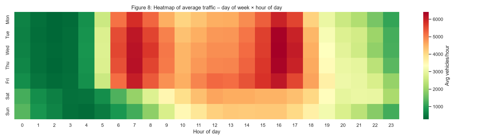
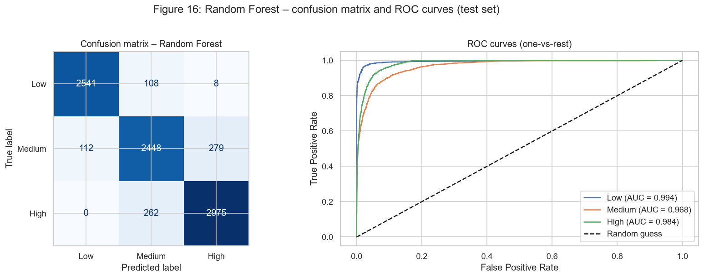
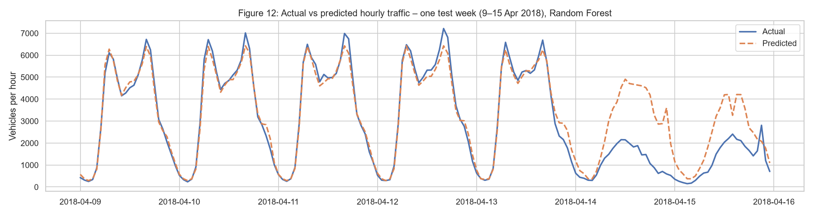
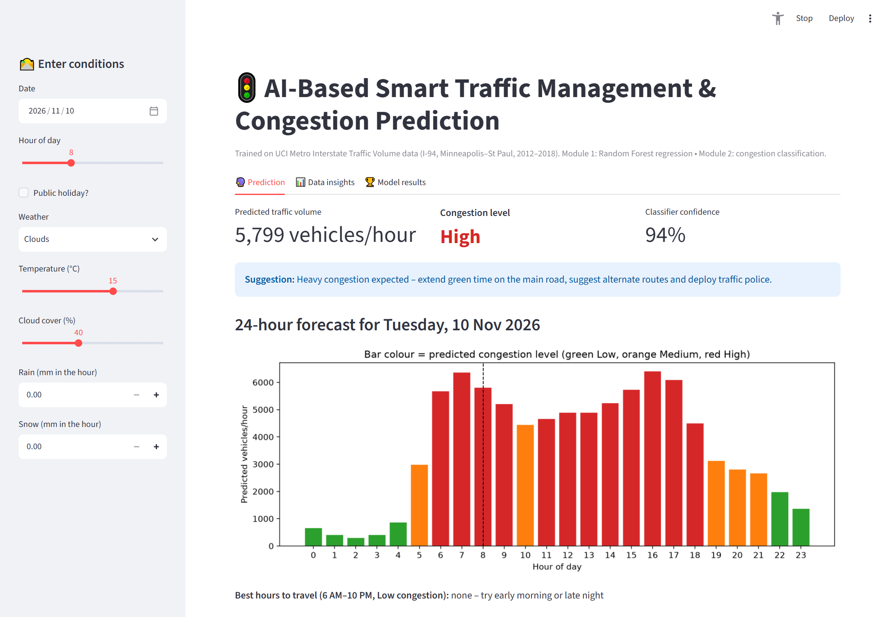
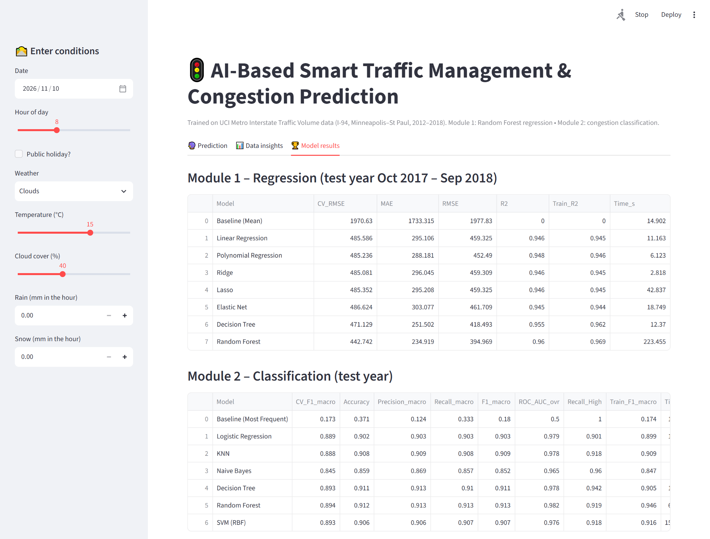

# 🚦 AI-Based Smart Traffic Management and Congestion Prediction System

> **CSE570 – Machine Learning with Python** · Skill Based Assignment (Academic Task 2) · Lovely Professional University
> **Author:** Anwar Husain ([@anwarhusain150](https://github.com/anwarhusain150))

An end-to-end machine-learning project that uses **historical hourly traffic and weather data** from the I-94
highway (USA) to:

1. **Predict traffic volume** (vehicles per hour) – *regression*
2. **Classify congestion level** as **Low / Medium / High** – *multi-class classification*

and presents both in an interactive **Streamlit dashboard** – 👉 [**Open the live dashboard**](https://anwarhusain150-smart-traffic-management-system-appapp-h521pm.streamlit.app/)


*Weekday rush hours (7 AM and 3–5 PM) are the most congested time slots.*

---

## 📌 Problem Statement
Traffic congestion wastes travel time and fuel and increases pollution. City traffic departments usually react
*after* congestion appears. If they could **forecast** how busy a road will be at a given hour, they could
plan signal timings, diversions and police deployment **in advance**.

| Item | Module 1 – Volume Prediction | Module 2 – Congestion Classification |
|---|---|---|
| ML task | Regression | Multi-class classification |
| Target | `traffic_volume` (vehicles/hour) | `congestion_level` – Low (< 2000), Medium (2000–4499), High (≥ 4500) |
| Success criteria | R² ≥ 0.90 on unseen test year, MAE far below baseline | Macro F1 ≥ 0.85 and High-class recall ≥ 0.85 |
| Achieved | ✅ **R² = 0.960**, MAE = 235 | ✅ **Macro F1 = 0.913**, High recall = 0.919 |

**Intended users:** traffic control rooms, city planners, and commuters planning travel times.
**Assumptions / constraints:** historical data only (no live feed or cameras); one road segment; the
Low/Medium/High thresholds are chosen for this road's distribution.

## 📊 Dataset
**Metro Interstate Traffic Volume** – UCI Machine Learning Repository (ID 492)
🔗 https://archive.ics.uci.edu/dataset/492/metro+interstate+traffic+volume
Citation: Hogue, J. (2019). *Metro Interstate Traffic Volume* [Dataset]. UCI Machine Learning Repository. https://doi.org/10.24432/C5X60B

* Hourly westbound traffic at a Minnesota DoT station between Minneapolis and St Paul, **Oct 2012 – Sep 2018**
* **48,204 rows × 9 columns** raw → **40,564 clean hourly rows** after cleaning

| Column | Type | Description |
|---|---|---|
| holiday | Categorical | US holiday name (only on the 00:00 row) |
| temp | Numeric | Temperature in Kelvin (converted to °C) |
| rain_1h / snow_1h | Numeric | Rain / snow in mm in the hour |
| clouds_all | Numeric | Cloud cover % |
| weather_main / weather_description | Categorical | Weather type |
| date_time | Datetime | Hour of record |
| **traffic_volume** | Numeric | **Target** – vehicles per hour |

**Data quality found and fixed:** 17 exact duplicates, 7,612 repeated hours (one row per weather type),
10 rows with temperature 0 K, 1 row with 9,831 mm rain, holiday flag only on midnight rows, and a
2014–2015 sensor gap. Class balance after labelling: Low 30.9% · Medium 33.3% · High 35.8%.

## 🛠️ Methodology
```
Raw CSV → Cleaning → Feature engineering → EDA + statistical tests
       → Time-based split (train 2012-2017 | test Oct 2017-Sep 2018)
       → Pipeline(ColumnTransformer: scaling + one-hot, model) → GridSearchCV with TimeSeriesSplit
       → Evaluate on test year → Best model → Streamlit dashboard
```
* **Feature engineering:** hour, day of week, month, weekend flag, holiday flag (spread to whole day),
  rush-hour flag, cyclical `hour_sin`/`hour_cos`, and a `daytype_hour` interaction (e.g. `work_8` vs `off_8`).
* **No data leakage:** scaling/encoding inside the pipeline; `traffic_volume` never used as an input for classification;
  test year is strictly in the future of the training data.

### Syllabus mapping
| Unit | Topics used in this project |
|---|---|
| 1 | NumPy, Pandas, missing values, duplicates, encoding (one-hot), scaling (StandardScaler), train-test split |
| 2 | EDA, visualisation, correlation, outlier detection, feature engineering/transformation, preprocessing pipelines, t-test, ANOVA, chi-square |
| 3 | Linear, Multiple Linear, Polynomial, Ridge, Lasso, Elastic Net regression · MAE, MSE, RMSE, R² |
| 4 | Logistic Regression, KNN, Decision Tree, Random Forest, SVM, Naive Bayes · confusion matrix, accuracy, precision, recall, F1, ROC-AUC |

## 📈 Results (test year Oct 2017 – Sep 2018)

### Module 1 – Regression
| Model | MAE | RMSE | R² |
|---|---|---|---|
| Baseline (mean) | 1733.3 | 1977.8 | 0.000 |
| Linear Regression | 295.1 | 459.3 | 0.946 |
| Polynomial Regression (deg 3) | 288.2 | 452.5 | 0.948 |
| Ridge | 296.0 | 459.3 | 0.946 |
| Lasso | 295.2 | 459.3 | 0.946 |
| Elastic Net | 303.1 | 461.7 | 0.945 |
| Decision Tree | 251.5 | 418.5 | 0.955 |
| **Random Forest** ⭐ | **234.9** | **395.0** | **0.960** |

### Module 2 – Classification
| Model | Accuracy | Macro F1 | ROC-AUC | High recall |
|---|---|---|---|---|
| Baseline (most frequent) | 0.371 | 0.180 | 0.500 | 1.000 |
| Logistic Regression | 0.902 | 0.903 | 0.979 | 0.901 |
| KNN (k = 15) | 0.908 | 0.909 | 0.978 | 0.918 |
| Naive Bayes | 0.859 | 0.852 | 0.965 | 0.960 |
| Decision Tree | 0.911 | 0.911 | 0.978 | 0.942 |
| **Random Forest** ⭐ | **0.912** | **0.913** | **0.982** | 0.919 |
| SVM (RBF) | 0.906 | 0.907 | 0.976 | 0.918 |



### Key insights
* **Time is the main driver:** hour of day, weekday/weekend and holidays explain most of the variation.
  Weekday daytime traffic is ~37% higher than weekends (Welch t-test, p < 0.001).
* **Weather matters much less:** statistically significant (ANOVA p < 0.001) but only ~10% difference between weather types.
* **Random Forest** wins both modules; well-engineered linear models are only ~1–2% behind.
* **Limitation seen in the data:** during the April 2018 Minneapolis blizzard the model over-predicted
  traffic, because snowfall is barely recorded in the dataset.



## Dashboard preview

*Prediction tab: volume, congestion level, suggestion and a 24-hour colour-coded forecast.*



## ⚠️ Limitations and future work
* No information on accidents, roadworks, events or live traffic; snowfall poorly recorded.
* Single road segment – results may not transfer to other cities without retraining.
* Future: add lag features (traffic in previous hours), event/accident data, gradient boosting models, live data feed.

## 📁 Project Structure
```
Smart-Traffic-Management-System/
├── Dataset/       raw data (.csv.gz) and cleaned data
├── Notebooks/     01_data_cleaning · 02_eda · 03_regression · 04_classification
├── src/           data_preprocessing.py · model_utils.py · train_models.py
├── models/        best hyperparameters (.json); trained .joblib files are created locally
├── app/           app.py – Streamlit dashboard
├── Images/        all figures
├── Reports/       result tables and final report
└── requirements.txt
```

## ▶️ How to Run
```bash
git clone https://github.com/anwarhusain150/Smart-Traffic-Management-System.git
cd Smart-Traffic-Management-System
python -m venv .venv
.venv\Scripts\activate            # Windows  (Linux/Mac: source .venv/bin/activate)
pip install -r requirements.txt

python src/train_models.py        # trains final models (~1-2 minutes)
streamlit run app/app.py          # opens the dashboard in your browser
```
The notebooks can also be opened in **VS Code** or **Google Colab** and run top to bottom.

### Deploying the dashboard (Streamlit Community Cloud)
The app is deployed from this repository with main file `app/app.py`; `app/requirements.txt` lists the
minimal libraries. On first start the app trains the final models (about 1–3 minutes), then caches them.

## 🧰 Tech Stack
Python 3.11 · NumPy · Pandas · Matplotlib · Seaborn · SciPy · Scikit-learn · Joblib · Streamlit · Jupyter · Git & GitHub

## 📚 References
1. Hogue, J. (2019). Metro Interstate Traffic Volume. UCI Machine Learning Repository. https://doi.org/10.24432/C5X60B
2. Pedregosa, F. et al. (2011). Scikit-learn: Machine Learning in Python. *JMLR* 12, 2825–2830.
3. McKinney, W. (2010). Data Structures for Statistical Computing in Python. *Proc. 9th Python in Science Conf.*
4. Hunter, J. D. (2007). Matplotlib: A 2D Graphics Environment. *Computing in Science & Engineering* 9(3).
5. Waskom, M. (2021). seaborn: statistical data visualization. *JOSS* 6(60), 3021.
6. Virtanen, P. et al. (2020). SciPy 1.0. *Nature Methods* 17, 261–272.
7. Streamlit documentation – https://docs.streamlit.io

## 🔗 Links
* GitHub: https://github.com/anwarhusain150/Smart-Traffic-Management-System
* **Live dashboard:** https://anwarhusain150-smart-traffic-management-system-appapp-h521pm.streamlit.app/
* **LinkedIn post:** https://www.linkedin.com/feed/update/urn:li:activity:7525983987937443840/

⭐ If you find this project useful, please give it a star!
